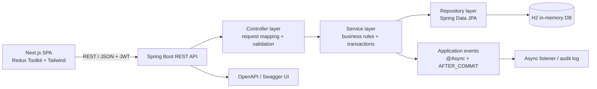
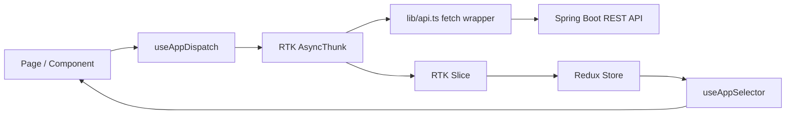
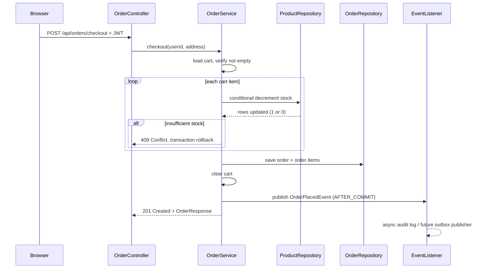

# Architecture Overview

## Selected use case

**Use Case 2 – E-Commerce Order & Inventory**. It was selected because it covers the required registration/login, catalog, cart, checkout, order history and admin CRUD features, while also demonstrating concurrency control, event handling and scalability-oriented design.

## High-level architecture

## MVC mapping

| MVC concern | Backend implementation |
|---|---|
| Model | JPA entities in `domain/*`, DTOs in `dto/*`, repositories in `repository/*` |
| View | Next.js App Router pages in `frontend/app/*` and reusable components in `frontend/components/*` |
| Controller | `controller/*` classes annotated with `@RestController` |

The backend follows a layered MVC style with additional service and repository layers:

1. **Controller** – maps HTTP verbs/paths, validates `@Valid` request bodies, maps principal to user id.
2. **Service** – owns transactions, orchestration, stock checks, order numbering and event publication.
3. **Repository** – Spring Data JPA queries, including a conditional bulk stock update.
4. **Model** – JPA entities with optimistic `@Version` and auditing timestamps.

## Frontend state flow

Slices:

- `authSlice` – token/user persisted in `localStorage`, hydration on app start.
- `productSlice` – catalog list, detail, filters, admin CRUD status.
- `cartSlice` – cart fetch/add/update/remove.
- `orderSlice` – order history and checkout.

## Request flow: checkout

## Concurrency and scalability considerations

- **Stock updates** use a single conditional `UPDATE ... WHERE stock_quantity >= :quantity`, so two concurrent checkouts cannot both consume the last unit. A `0` row count maps to `409 Conflict`.
- **Optimistic locking** via `@Version` on all entities protects aggregate updates.
- **Transactions** are service-level and read-only where possible.
- **Open session in view is disabled**; DTO mapping happens inside service transactions.
- **Events** are published after commit and processed on a bounded async executor, keeping checkout latency low.
- **Stateless JWT auth** allows horizontal scaling of API instances without server sessions.
- **H2 is used for portability** in this assessment; the repository/SQL layer is ANSI-friendly, so switching to PostgreSQL later mainly requires datasource configuration and a migration tool such as Flyway.
- **Pagination and whitelisted sorting** protect catalog endpoints from unbounded queries and unsafe sort fields.
- **CI/CD** builds and tests both applications on every push/PR and publishes a versioned backend JAR from `main`.

## Security

- BCrypt password hashing.
- JWT (HS256) bearer authentication with configurable secret and expiry.
- Role-based access: `ROLE_USER` for cart/orders, `ROLE_ADMIN` for product management.
- Method-level `@PreAuthorize("hasRole('ADMIN')")` in addition to URL rules.
- Consistent JSON error responses for 400/401/403/404/409/500 with trace ids.
- Request logging intentionally excludes payloads to avoid logging credentials/PII.
